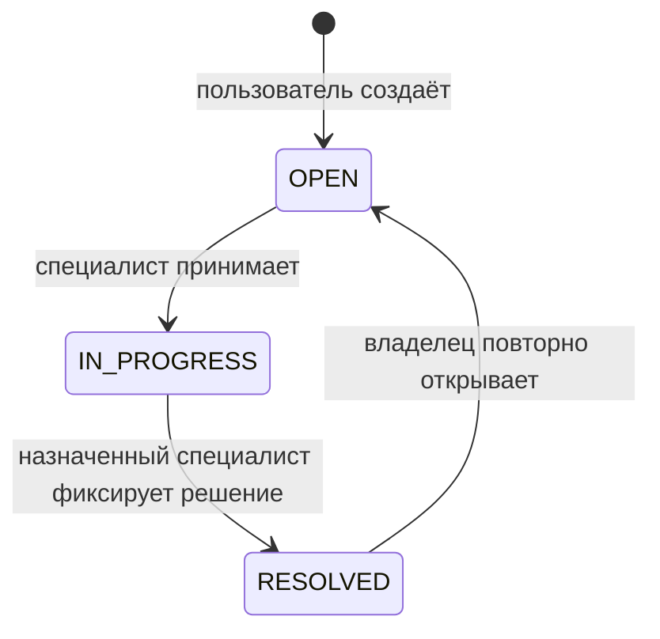

# API и правила доступа

Все данные учебные. Ответы с обращениями возвращаются как JSON, текст не интерпретируется сервером как HTML. Если позднее появится интерфейс, экранирование при отображении станет отдельным требованием.

## Аутентификация

1. `GET /api/csrf` создаёт сессию при необходимости и возвращает `token` и `headerName`.
2. `POST /api/login`: форма `application/x-www-form-urlencoded`, поля `username`, `password`; заголовок `X-CSRF-TOKEN` содержит полученный токен, cookie сохраняется клиентом. Успех — 204, неправильные данные — 401, отсутствие CSRF — 403.
3. После входа снова получите `/api/csrf`: Spring Security меняет идентификатор сессии и сбрасывает старый CSRF-токен.
4. Все последующие POST содержат актуальный токен и cookie. `POST /api/logout` возвращает 204 и завершает сессию.

Готовый клиент, включая этот обмен, находится в [scripts/smoke.py](../scripts/smoke.py). Пароль не передаётся в URL. Сессия истекает после 15 минут бездействия. Cookie — HttpOnly и SameSite=Strict; для HTTPS предусмотрена переменная `COOKIE_SECURE=true`. CORS для сторонних сайтов не разрешён.

## Операции

| Метод и путь | Кто | Тело / результат |
| --- | --- | --- |
| GET `/health` | Любой | Состояние процесса, без деталей БД |
| GET `/api/me` | Вошедший | ID, имя и роль, без хэша пароля |
| GET `/api/tickets?offset=0` | Пользователь / специалист | Свои / назначенные обращения, до 50 |
| GET `/api/queue?offset=0` | Специалист | Открытые неназначенные обращения: только ID, заголовок, время |
| POST `/api/tickets` | Пользователь | `{"title":"...","description":"..."}`, 201 |
| GET `/api/tickets/{id}?offset=0` | Владелец / назначенный специалист | Обращение и до 50 доступных сообщений |
| POST `/api/tickets/{id}/claim` | Специалист | Без тела; взять свободное обращение |
| POST `/api/tickets/{id}/comments` | Владелец / назначенный специалист | `{"body":"..."}`, 204 |
| POST `/api/tickets/{id}/internal-notes` | Назначенный специалист | `{"body":"..."}`, 204 |
| POST `/api/tickets/{id}/resolve` | Назначенный специалист | `{"body":"Текст решения"}` |
| POST `/api/tickets/{id}/reopen` | Владелец | Без тела; вернуть решённое обращение в очередь |

`offset` — число от 0 до 10000; это смещение списка обращений или доступных сообщений. Внутренние сообщения отфильтровываются до ограничения страницы. Порядок стабилен по времени и ID.

## Правила, которые нельзя менять через тело запроса

- Автор берётся из серверной сессии. Нельзя передать другого автора, исполнителя, роль, статус или признак внутренней заметки.
- Неизвестные поля JSON отклоняются с 400. Заголовок содержит от 1 до 120 символов, описание и сообщение — от 1 до 4000; пробельные строки отклоняются. JSON ограничен 32 КиБ до разбора.
- Пользователь видит только свои обращения, включая повторно открытые. Чужой и несуществующий ID дают одинаковый ответ 404.
- Специалист видит подробности только назначенных ему обращений. Заголовки очереди доступны всем специалистам, поэтому в заголовке нельзя размещать чувствительные сведения. Это осознанное бизнес-правило, а не случайная утечка полного текста.
- Внутренние заметки доступны назначенному специалисту. После повторного открытия предыдущий специалист теряет доступ; новый назначенный специалист получает историю, включая внутренние заметки. Передача истории нужна для продолжения решения.
- Любое изменение обращения и чтение подробностей удерживает блокировку строки до конца транзакции. Это согласует проверку доступа с чтением сообщений и исключает двойное назначение.
- В состоянии RESOLVED добавлять комментарии и заметки нельзя. Сначала владелец повторно открывает обращение.

Повторное назначение занятого обращения и недопустимый переход дают 409. Запрещённая операция роли — 403, отсутствие входа — 401. Ошибки не включают SQL, параметры запроса и стек вызовов. Журнал `audit_event` хранит автора, ID обращения, тип действия и время, но не текст сообщения или пароль. Он пока не защищён от изменения с полномочиями владельца таблицы и не является неизменяемым журналом.
