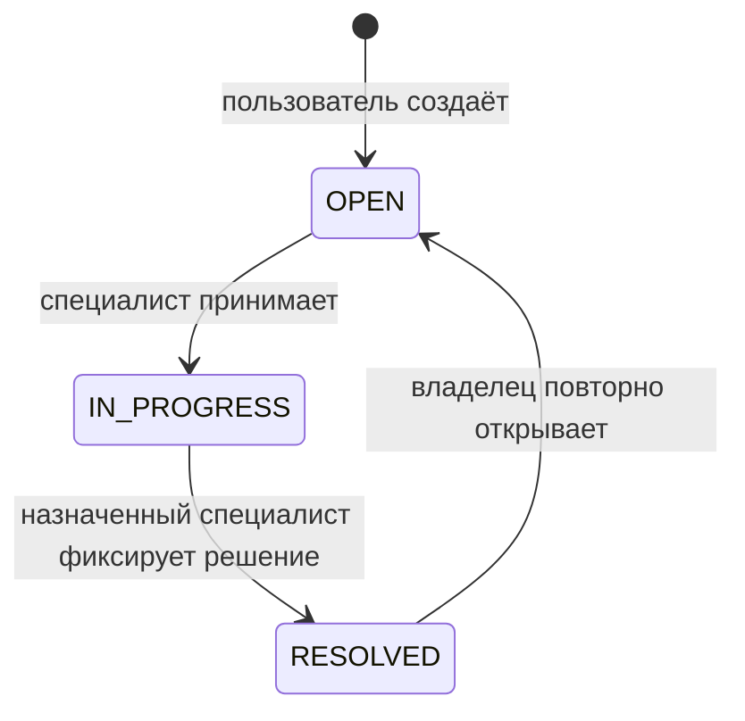

# API и правила доступа

Все данные учебные. Ответы с обращениями возвращаются как JSON, текст не интерпретируется сервером как HTML.
Если позднее появится интерфейс, экранирование при отображении станет отдельным требованием.

## Аутентификация

1. `GET /api/csrf` создаёт сессию при необходимости и возвращает `token` и `headerName`.
2. `POST /api/login`: форма `application/x-www-form-urlencoded`, поля `username`, `password`; заголовок `X-CSRF-TOKEN` содержит полученный токен, cookie сохраняется клиентом.
   Успешный запрос — 204, неправильные данные — 401, отсутствие CSRF — 403. После 10 попыток за 60 секунд с одного транспортного адреса — 429 и `Retry-After`; учитываются также успешные входы. Подставленные заголовки адреса не меняют счётчик.
3. После входа снова получите `/api/csrf`: Spring Security меняет идентификатор сессии и сбрасывает старый CSRF-токен.
4. Все последующие POST содержат актуальный токен и cookie. `POST /api/logout` возвращает 204 и завершает сессию.

Готовый клиент, включая этот обмен, находится в [scripts/smoke.py](../scripts/smoke.py).
Пароль не передаётся в URL. Сессия настроена на истечение после 15 минут бездействия. Лимит входа хранится в памяти одного процесса и сбрасывается при его перезапуске.

После входа cookie `JSESSIONID` хранит идентификатор сессии: по нему сервер узнаёт пользователя в следующих запросах. Сам пароль в этой cookie не хранится.

- `HttpOnly` запрещает JavaScript на странице читать cookie. Браузер продолжает прикладывать её к подходящим запросам.
- `SameSite=Strict` запрещает отправлять эту cookie в межсайтовом контексте, например при переходе с постороннего сайта. Это дополнительная защита вместе с CSRF-токеном.
- Признак `Secure` предназначен для передачи cookie по HTTPS. Приложение поддерживает переменную окружения `COOKIE_SECURE=true`; сама переменная не настраивает HTTPS. В текущем Compose используется локальный HTTP, а эта переменная в контейнер не передаётся.
- CORS задаёт, каким другим источникам (сочетаниям протокола, хоста и порта) браузер разрешает доступ к ответам API. В проекте такие разрешения не настроены. Это не заменяет проверку прав: CORS не ограничивает обычный HTTP-клиент и не запрещает отправку всех межсайтовых запросов.

## Операции

| Метод и путь | Кто | Тело / результат |
| --- | --- | --- |
| GET `/health` | Любой | Состояние процесса, без деталей БД |
| GET `/api/me` | Вошедший | ID, имя и роль, без хэша пароля |
| GET `/api/tickets?offset=0` | Пользователь / специалист | Свои / назначенные обращения, до 50 |
| GET `/api/queue?offset=0` | Специалист | Открытые неназначенные обращения: только ID, заголовок, время |
| POST `/api/tickets` | Пользователь | `{"title":"...","description":"..."}`, 201 |
| GET `/api/tickets/{id}?offset=0` | Владелец / назначенный специалист | Обращение и до 50 доступных сообщений |
| POST `/api/tickets/{id}/claim` | Специалист | Без тела; взять свободное обращение |
| POST `/api/tickets/{id}/comments` | Владелец / назначенный специалист | `{"body":"..."}`, 204 |
| POST `/api/tickets/{id}/internal-notes` | Назначенный специалист | `{"body":"..."}`, 204 |
| POST `/api/tickets/{id}/resolve` | Назначенный специалист | `{"body":"Текст решения"}` |
| POST `/api/tickets/{id}/reopen` | Владелец | Без тела; вернуть решённое обращение в очередь |

`offset` — число от 0 до 10000; это смещение списка обращений или доступных сообщений. Внутренние сообщения отфильтровываются до ограничения страницы. Порядок стабилен по времени и ID.

## Правила, которые нельзя менять через тело запроса

1. Автор берётся из серверной сессии. Нельзя передать другого автора, исполнителя, роль, статус или признак внутренней заметки.
2. Неизвестные поля JSON отклоняются с 400 (соответствует ошибке со стороны клиента). Заголовок содержит от 1 до 120 символов, описание и сообщение — от 1 до 4000; пробельные строки отклоняются. JSON ограничен 32 КиБ до разбора.
3. Пользователь видит только свои обращения, включая повторно открытые. Чужой и несуществующий ID дают одинаковый ответ 404.
4. Чтобы выбрать обращение из общей очереди, каждый специалист видит его ID, заголовок и время создания. Описание, переписка и внутренние заметки доступны только после назначения обращения этому специалисту. Поэтому заголовок должен кратко обозначать проблему, например «Не работает принтер», без паролей и других чувствительных сведений. Автоматической проверки заголовка на такие сведения нет: если их туда вписать, они будут видны всем специалистам.
5. Внутренние заметки доступны назначенному специалисту. После повторного открытия предыдущий специалист теряет доступ; новый назначенный специалист получает историю, включая внутренние заметки. Передача истории нужна для продолжения решения.
6. Любое изменение обращения и чтение подробностей удерживает блокировку строки до конца транзакции. Это согласует проверку доступа с чтением сообщений и исключает двойное назначение.
7. Обращению, находящемуся в состоянии RESOLVED, добавлять комментарии и заметки нельзя. Сначала владелец повторно открывает обращение.

Повторное назначение занятого обращения и недопустимый переход дают 409. Запрещённая операция роли — 403, отсутствие входа — 401.
Ошибки не включают SQL, параметры запроса и стек вызовов.
Журнал `audit_event` хранит автора, ID обращения, тип действия и время, но не текст сообщения или пароль. Он пока не защищён от изменения с полномочиями владельца таблицы и не является неизменяемым журналом.
