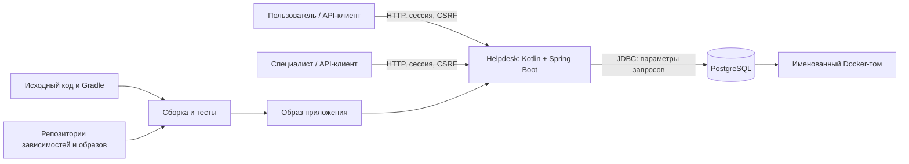

# Проект: Helpdesk, планируемый выпуск v1.0.0

Этот документ подготовлен для ЭК1 курса «Разработка безопасного ПО». Разделы 1–5 описывают выбранный объект, методологию, фактическое состояние, целевой процесс и план апробации. Результаты исходных проверок подтверждают работоспособность каркаса; итоговое решение о выпуске будет принято на ЭК2.

Логика документа: что защищаем → какие практики выбираем → что уже работает и чего не хватает → как организуем разработку → что проверим на следующем этапе. Обозначения нужны для ссылок между разделами: R — риск, A — выбранная практика, G — выявленный пробел, Q — контрольная точка, M — метод проверки.

## 1. Паспорт проекта

**Участник:** [VladislavKabakov](https://github.com/VladislavKabakov).

**Название проекта и команды:** Helpdesk.

**Формат:** индивидуальное выполнение.

**Продукт:** серверный сервис для регистрации и решения обращений пользователей.

**Планируемый выпуск:** `v1.0.0` для локальной учебной среды; код каркаса имеет версию `0.1.0`.

**Исходное состояние (baseline):** commit `f58554c3ef048ac3652e2c265c48a76c30e78e91`, tag `baseline-ek1`; каркас до дальнейших улучшений для ЭК2. Проверка: `git rev-parse baseline-ek1^{commit}`.

**Срез ЭК1:** tag `ek1`. Архив для ЭИОС формируется командой `git archive` из этого тега; исходное состояние отдельно доступно по `baseline-ek1`.

**Репозиторий:** [VladislavKabakov/helpdesk](https://github.com/VladislavKabakov/helpdesk), публичный.

### Контекст и пользователи

Продукт рассматривается как небольшой внутренний сервис поддержки учебной организации. Контекст условный: реального заказчика, производственной среды и данных сотрудников нет.

Описание процесса взаимодействия с системой:

1. Пользователь сообщает о проблеме, просматривает свои обращения и ответы.
2. Специалист выбирает обращение из очереди, принимает его в работу, обсуждает проблему и записывает решение. Внутренние заметки нужны для служебной диагностики и не предназначены пользователю. При повторном открытии обращение возвращается в очередь, а следующий специалист получает всю историю.

Для пользователя важны конфиденциальность переписки и достоверный статус решения. Для специалиста — корректное назначение и возможность сохранить внутренние сведения. Регистрация, самостоятельная смена пароля и управление персоналом пока не входят в продукт: четыре искусственные учётные записи создаются в отдельном демонстрационном режиме.

### Границы

В проект входят REST API, сессии и проверка полномочий, PostgreSQL, миграции Flyway, зависимости Gradle, Dockerfile, Compose, тесты, инструкция запуска и конфигурация GitHub Actions. Один выпуск включает согласованное состояние исходного кода, схемы БД, образа приложения и документации.

За границами остаются браузерный интерфейс, почта, загрузка файлов, корпоративный вход, несколько организаций, платёжные операции, публичный сервер и инфраструктура GitHub как сервиса. Настройки собственного репозитория и workflow остаются в области проектирования процесса. Реальные персональные данные и производственные секреты не используются.

Ограничение оправдано: текстовые обращения уже дают законченный процесс и существенные задачи защиты. Вложения и внешние интеграции увеличили бы объём анализа без необходимости для выбранного выпуска. Подробный [контракт API](docs/api.md) задаёт действия ролей и переходы статусов.

### Компоненты, взаимодействия и границы доверия

| Граница | Что проходит | Почему существенна |
| --- | --- | --- |
| Клиент → API | Пароль, cookie, ID обращения, текст и команды | Клиент полностью недоверенный; ID и заявленная роль не являются разрешением |
| Пользователь → данные другого пользователя | Попытка доступа через ID и списки | Должна сохраняться изоляция обращений при каждом чтении и изменении |
| Пользователь → полномочия специалиста | Назначение, решение, внутренние заметки | Требуются проверки операции, объекта и доступных полей |
| API → PostgreSQL | Параметризованные запросы и миграции | Нельзя превращать входной текст в SQL; полномочия соединения ограничивают последствия ошибки |
| Код и внешние компоненты → образ | Зависимости, плагины, базовые образы | Изменение состава сборки влияет на доверие к проверенному выпуску |
| Локальная среда → GitHub | Код, конфигурация, результаты проверок | `.env` и другие секреты не должны попасть в историю или артефакты CI |

Loopback ограничивает доступ к API с сети, но не делает клиент доверенным. Пользователь компьютера с доступом к Docker считается администратором среды; защита от такого администратора не обещается.

### Активы и существенные риски

Ниже перечислены сценарии риска, а не заявления о найденных уязвимостях. Приоритет определяется возможностью нарушить главное обещание продукта и ущербом в заявленной среде. Для сетевой публикации оценку потребуется пересмотреть.

| ID | Актив и сценарий | Последствие и приоритет | Текущее решение / будущая проверка |
| --- | --- | --- | --- |
| R01 | Текст и история чужого обращения: подстановка ID или обход через список | Раскрытие переписки; высокий | Проверка владельца в сервисе и фильтрация выборки; M1, M2 |
| R02 | Внутренняя заметка: выдача вместе с публичной перепиской | Раскрытие служебных сведений; высокий | Фильтрация до пагинации; M1, M2 |
| R03 | Назначение и статус: пользователь вызывает операцию специалиста или подменяет поля | Ложное решение, изменение чужой работы; высокий | Отдельные команды, роль из БД, неизвестные JSON-поля запрещены; M1, M2 |
| R04 | Сессия: поддельный межсайтовый запрос (CSRF), фиксация сессии, повторное использование после выхода | Действия от имени другого лица; высокий | CSRF, смена ID при входе, завершение сессии, cookie; M2, M5 |
| R05 | Учётная запись: подбор пароля или офлайн-перебор хэша | Захват полномочий; высокий для публичной среды | BCrypt cost 12; нет ограничения частоты входа; G03, M5 |
| R06 | База: SQL-инъекция через входной текст | Чтение или изменение данных; высокий | Параметры JDBC, статические имена колонок; M2, M3 |
| R07 | Право назначения: два специалиста принимают одно обращение | Противоречивый исполнитель и аудит; средний | Блокировка строки и транзакция; M2 |
| R08 | Журналы и ошибки: пароль, cookie или текст в диагностике | Вторичный канал утечки; высокий | Ограниченный ответ ошибки и журнал действий без содержания; M3, M5 |
| R09 | Доступность: большие тела, множество запросов и сессий | Исчерпание памяти или соединений; средний локально | Лимит JSON и страниц, ограниченный пул и память; остаются G03, M5 |
| R10 | Зависимости и образ: известная уязвимость или подмена компонента | Компрометация приложения/сборки; высокий | Lock-файл, SHA дистрибутива и digest образов; анализа состава ещё нет, G02, M4 |
| R11 | Секреты БД: публикация `.env` или попадание в слой образа | Доступ к данным; высокий | Случайные локальные секреты, исключения Git/Docker; M3, M6 |
| R12 | Данные и аудит: ошибка приложения с правами владельца таблиц | Потеря данных, изменение истории; высокий | Нет superuser, но DDL доступен для Flyway; G04, G05, M6 |
| R13 | Образ выпуска: опубликован другой код, чем проверен | Недостоверное основание выпуска; высокий | Фиксация версии и проверок; правила Q3–Q4, M7 |

### Доступные материалы и ограничения

Доступны весь исходный код, миграции, конфигурация, прямые и транзитивные зависимости, автоматические тесты и Docker-среда. Исходное состояние фиксируется локально в Git. Приложение можно изменить и повторить проверку самостоятельно; лицензии внешних сервисов и закрытые рабочие материалы не нужны.

Непрерывная интеграция (CI) проверена фактическим запуском GitHub Actions: сборка, тесты и проверка документов прошли. Результаты и ссылка на запуск собраны в [evidence/verification.md](evidence/verification.md); они не распространяются на неизвестную производственную среду. Пример исходного Kotlin/Gradle-проекта использован только как ориентир сборки; его данные и конфигурационные секреты не переносились.

Выполнимость обеспечивается небольшим числом сущностей, единой БД, локальным запуском и воспроизводимыми сценариями. Для ЭК2 можно улучшить ограничение попыток входа или разделение полномочий БД и проверить результат до и после. Окончательное улучшение выбирается после апробации, а не под заранее придуманный дефект.

## 2. Методологическая основа

### Требования к основе и сравнение кандидатов

Нужна рамка, охватывающая путь от требований до выпуска и обработки проблем, допускающая одного исполнителя, не зависящая от языка и не требующая недоступной производственной инфраструктуры. Положения должны превращаться в конкретные действия, результат которых можно проверить. Версии документов указаны в таблице; сравнение опирается на [материалы курса](https://github.com/hse-rbpo-master-2026/course/blob/5ce5fdf4ba4bb32ac62d1b9c6728f3a6d8fa6884/resources.md).

| Кандидат | Назначение и применимость | Адаптация и ограничения | Доступ и решение |
| --- | --- | --- | --- |
| **NIST SP 800-218, SSDF 1.1** | Практики безопасной разработки на всём жизненном цикле; подходят небольшому API | Ответственность совмещается, выбираются семь задач; нет готового локального процесса и детальных правил доступа | Открыт полный официальный текст; **основная рамка** |
| **OWASP SAMM 2** | Оценка зрелости и программа развития практик | Для нового продукта почти нет истории, чтобы обосновать уровни; полноценная оценка организации несоразмерна | Открытая модель; сравнили, **не включаем** в профиль |
| **ГОСТ Р 56939-2024** | Требования к процессам разработки безопасного ПО; применим при соответствующем контексте | Потребуется отбор процессов и упрощение ролей; обязательное применение заказчиком для данного учебного продукта не установлено | Для сравнения использованы L02 и карточка из курса; полный текст в этом комплекте не воспроизводится; **не выбран** |
| **ISO/IEC 27034-1:2011** | Управление безопасностью приложения в организации, включая отношения сторон | Сложный организационный контекст отсутствует; общая рамка требует значительной конкретизации | Официальная карточка и L03 доступны, полный текст не заявляется изученным; **не выбран** |
| **IEC 62443-4-1:2018** | Жизненный цикл продукта для промышленной автоматизации | Helpdesk не промышленный компонент; отраслевые требования не дают полезного основного каркаса | Официальная карточка и L03 доступны; **не выбран** |

Дополнительный источник — [OWASP ASVS 5.0.0](https://github.com/OWASP/ASVS/tree/v5.0.0), только для конкретизации технических требований. Используем 8.1.1–8.1.2 (документирование доступа к операциям, объектам и полям), 8.2.1–8.2.3 (его реализация), 8.3.1 (проверка в доверенном сервисном слое) и 6.3.1 (защита от перебора). Это выборочные требования; соответствие полному уровню ASVS не заявляется. Сам ASVS не заменяет процессную рамку SSDF.

### Адаптация семи задач SSDF

Оригинальные формулировки проверены по [NIST SP 800-218](https://doi.org/10.6028/NIST.SP.800-218). Ниже дано краткое изложение смысла и наше локальное решение. Указанные инструменты и интервалы проверки выбраны для Helpdesk, а не предписаны NIST.

**A01 — PO.1.2: определить и поддерживать требования безопасности к разрабатываемому ПО.** Применимо полностью в границах продукта. Для каждого изменения определяются затронутые риски R01–R13 и при необходимости обновляются правила [API](docs/api.md). Результат — конкретное разрешённое/запрещённое поведение и соответствующий тест или план. Проверка: для чтения, записи и переходов состояний можно определить действующее лицо, объект и ожидаемый ответ. Исключены требования к отсутствующим почте, файлам и внешнему входу; при их добавлении профиль пересматривается.

**A02 — PO.2.1: определить роли и обязанности на всём жизненном цикле.** Применимо частично: один студент выполняет разработку, самопроверку и подготовку выпуска. Результат — распределение функций и процедура самостоятельной проверки в разделе 4. Проверка: для каждой контрольной точки назван ответственный и сохраняемый результат. При индивидуальной работе независимой проверки нет; это ограничение учтено в G07. Полученные замечания преподавателя сохраняются вместе с исправлениями.

**A03 — PO.4.1: определить критерии проверок безопасности и отслеживать их в жизненном цикле.** Применимо полностью. Условия перехода между этапами заданы в Q1–Q4; результаты обязательных проверок и отклонения сохраняются. Результат — протокол с версией, исходом и ссылками. Проверка: провал контроля доступа блокирует выпуск; отсутствие запуска не считается успешным тестом. Исключения имеют основание, срок и компенсирующую меру.

**A04 — PS.1.1: хранить код и конфигурации с минимально необходимыми правами.** Применимо к репозиторию и сборке. Код хранится в Git, локальные секреты исключены из публикации, права workflow ограничены чтением, сторонние actions закреплены коммитами. Перед публикацией проверяются история и права репозитория. Результат — история изменений, конфигурация CI и проверка комплектности. Проверка: секреты исключены, изменения прослеживаются, доступ на запись предоставлен только необходимым субъектам. Публичное чтение исходников разрешено; защита ветки от обхода проверок не заявляется.

**A05 — PW.4.4: проверять сторонние компоненты на соответствие требованиям проекта в течение их жизненного цикла.** Применимо полностью для используемых компонентов. Версии зависимостей и образы зафиксированы. Перед выпуском планируются перечень компонентов (SBOM) и анализ известных уязвимостей. Результат — отчёт с датой базы уязвимостей и решениями по находкам. Проверка: отчёт относится к нужной версии, прямые и транзитивные зависимости сопоставлены с поставкой. Отчёт планируется на ЭК2. Полный аудит исходников всех сторонних библиотек выходит за границы работы.

**A06 — PW.8.2: определить область тестирования, провести его и разобрать обнаруженные проблемы.** Применимо полностью. Сценарии связаны с рисками: проверяются разрешённые и запрещённые действия, а также одновременные запросы на PostgreSQL. Проверка: нарушение ожидаемого поведения приводит к падению соответствующего теста. Результат — исходники тестов, XML и интерпретация охвата. Нагрузочная устойчивость и все возможные последовательности запросов не следуют из прохождения небольшой регрессии.

**A07 — RV.2.1: собрать сведения о риске для выбора реакции на уязвимость.** Применимо полностью как правило обработки. Для находки сохраняются версия, сценарий, влияние, применимость, приоритет и решение. После исправления повторяются исходный сценарий и тесты связанных функций. Результат — запись о разборе с проверяемым основанием. Проверка: сырой вывод сканера не приравнен к подтверждённой уязвимости, исключение не скрывает блокирующую проблему.

Эти семь задач охватывают требования, ответственность, защиту материалов, компоненты, проверки и реакцию. Полное соответствие SSDF не заявляется. При анализе текущего состояния особенно проверяются воспроизводимость, права БД и отсутствие контроля частоты входа. Детальный технологический выбор остаётся предварительным до лекций 06–08.

## 3. Текущее состояние

### Выборка и фактический путь изменения

Основная выборка — два локальных коммита от 26 сентября: `f58554c` (исходный каркас) и `2d7627f` (уточнение паспорта и результат чистого запуска). 5 октября повторно просмотрены код, конфигурации, тесты, документы и правки README. Истории производственных выпусков и pull request у продукта пока нет; устойчивость процесса по двум коммитам не оценивается.

| Переход | Статус и след | Ограничение вывода |
| --- | --- | --- |
| Требования → код и тесты | Наблюдается: состав `f58554c`, код сценариев и раздел 12 об ИИ | Порядок каждого действия до первого коммита не восстанавливается |
| Проверка каркаса → фиксация результата | Наблюдается: локальные запуски и повторение из чистой копии в [протоколе](evidence/verification.md); `2d7627f` меняет только документы и свидетельство | Не доказана обязательность проверки для каждого будущего изменения |
| Правки документации → комплект ЭК1 | Наблюдается: изменения README и финальная сверка требований; след остаётся в истории подготовки `ek1` | Проверка помощником не равнозначна независимому просмотру человеком |
| Изменение → обязательный контроль перед слиянием | Заявлено как целевое правило Q2; в исходной выборке нет слияний и настроенного запрета обхода | Наличие workflow не доказывает защиту ветки |
| Комплект → продуктовый выпуск `v1.0.0` | Не наблюдалось: тег выпуска и решение ещё не создавались; Q3–Q4 являются планом | `ek1` не подтверждает готовность к эксплуатации |

Сохраняем работающие элементы: тесты используют PostgreSQL и реальную аутентификацию, миграции автоматизированы, исходники связаны с результатами контрольными суммами. История проекта пока короткая, поэтому регулярность выполнения проверок предстоит оценить по дальнейшим изменениям на ЭК2.

### Что существует на момент ЭК1

Каркас создан для курса с помощью ИИ и затем проверен инструментально. Продукт ещё не эксплуатировался; выводы основаны на файлах, локальных запусках и тестах.

| Наблюдение | Проверяемое основание | Граница вывода |
| --- | --- | --- |
| Kotlin-приложение собирается Gradle Wrapper | [build.gradle.kts](build.gradle.kts), [протокол](evidence/verification.md) | Сборка не доказывает отсутствие уязвимостей |
| Схема создаётся автоматически | [миграция V1](src/main/resources/db/migration/V1__initial_schema.sql), Flyway в [настройках](src/main/resources/application.yml) | Восстановление из резервной копии пока не проверено |
| Правила доступа находятся в сервисном слое | [TicketService.kt](src/main/kotlin/ru/course/helpdesk/TicketService.kt) | Нужны регрессионные проверки при изменении каждого пути доступа |
| Используются серверные сессии и CSRF | [SecurityConfig.kt](src/main/kotlin/ru/course/helpdesk/SecurityConfig.kt) | Нет MFA, ограничения попыток входа и проверки публичного TLS |
| Есть интеграционная регрессия | [HelpdeskIntegrationTest.kt](src/test/kotlin/ru/course/helpdesk/HelpdeskIntegrationTest.kt) | MockMvc не проверяет всю сеть и настройки контейнера; дополнительно нужен smoke |
| Образ запускается без root, БД не публикует порт | [Dockerfile](Dockerfile), [compose.yaml](compose.yaml) | Администратор Docker имеет доступ к данным и переменным окружения |
| CI выполнил сборку, тесты и проверку документов | [verify.yml](.github/workflows/verify.yml), [результат GitHub Actions](evidence/github-actions.json) | Успех конкретного запуска не доказывает защиту ветки или безопасность всех зависимостей |

Результаты запусков и версии среды приведены в [evidence/verification.md](evidence/verification.md). Эти проверки нужны уже для доверия к исходному каркасу; они не подменяют будущий план апробации целевого процесса.

### Существенные разрывы

| ID | Разрыв и основание | Почему важен | Приоритет и действие |
| --- | --- | --- | --- |
| G01 | В исходном состоянии CI существовал только файлом; до публикации удалённого запуска не было | Не было подтверждения проверки на GitHub runner и публичного доступа к комплекту | Закрыт для подготовки ЭК1: репозиторий опубликован, [CI прошёл](evidence/github-actions.json); защита ветки от обхода не заявляется |
| G02 | В исследованном комплекте нет отчёта анализа сторонних компонентов (SCA) и машиночитаемого перечня компонентов (SBOM) | Lock-файл фиксирует версии, но не отвечает на вопрос о применимых известных уязвимостях | Высокий для `v1.0.0`; M4 на ЭК2 |
| G03 | В SecurityConfig нет ограничения попыток входа; число новых сессий не ограничено прикладным правилом | Подбор пароля и расход CPU на BCrypt; loopback уменьшает доступность атаки, но не исправляет механизм | Высокий перед сетевой публикацией; M5, кандидат на улучшение |
| G04 | Flyway и запросы приложения выполняются одной ролью, владеющей таблицами | Ошибка выполнения кода или SQL имеет больший ущерб, чем при правах только на данные | Средний в локальной среде, высокий для реальных данных; разделить миграции и runtime на ЭК2 |
| G05 | Сохранение Docker-тома не является резервным копированием; восстановления из копии нет | Без проверенной копии после удаления тома или повреждения данных может быть нечего восстанавливать | Средний; проверить резервирование до работы с ценными данными, сейчас только синтетика |
| G06 | Аудит фиксирует успешные бизнес-действия, но нет полноценного журнала отказов и защищённого внешнего хранения | Сложнее обнаружить перебор и расследовать инцидент; обладатель прав БД может изменить аудит | Средний; определить безопасный состав событий и срок хранения на ЭК2 |
| G07 | Самопроверка выполнена тем же исполнителем, независимого review нет | Систематическая ошибка может остаться незамеченной | Средний остаточный риск; отдельный проход проверки, автоматические негативные тесты и вопросы защиты |

Отсутствие многоуровневого корпоративного процесса не считается самостоятельным дефектом. Приведённые разрывы связаны с конкретным сценарием ущерба или невозможностью обосновать выпуск. G01 относится к организационной готовности комплекта; G02–G07 задают дальнейшую работу и ограничения. Нельзя трактовать их все как подтверждённые эксплуатируемые уязвимости.

### Подробное основание ключевых разрывов

**G02 — решение о сторонних компонентах.** Ожидание из A05 и R10: перед `v1.0.0` знать состав поставки и разобрать применимые известные проблемы. В [lock-файле](gradle.lockfile) версии зафиксированы, но в исследованных `evidence/` и workflow нет отчёта анализа компонентов. Это нехватка основания для выпуска, а не доказательство уязвимости библиотеки. На ЭК2 сначала формируем состав и отчёт, затем разбираем применимость. Приоритет высокий для решения о выпуске; ближайший шаг — M4.

**G03 — ограничения входа.** Ожидание из R05 и ASVS 6.3.1: повторные неуспешные входы не должны допускать неограниченный перебор. В [SecurityConfig.kt](src/main/kotlin/ru/course/helpdesk/SecurityConfig.kt) нет такого прикладного механизма, а Compose не содержит ограничивающего прокси. Установлен пробел в контроле, но успешный подбор пароля и отказ сервиса не воспроизводились. Для loopback-сценария доступ атакующего ограничен; перед сетевой эксплуатацией приоритет высокий. Ближайший шаг — ограниченная проверка поведения M5, затем выбор улучшения по результату.

**G04 — полномочия БД.** Ожидание из R12: прикладному соединению достаточно операций с данными, изменение схемы должно быть отдельным действием сопровождения. [Скрипт инициализации](docker/init-db.sh) и [настройки](src/main/resources/application.yml) показывают одну роль для миграций и запросов; [проверка среды](evidence/runtime.json) подтверждает отсутствие superuser, но не разделение функций. Роль владеет таблицами, поэтому возможный ущерб ошибки шире необходимого. Это не утверждение о найденной SQL-инъекции. Приоритет средний для учебного запуска; M6 должен проверить отдельные роли и работоспособность миграций, если это улучшение выбрано на ЭК2.

## 4. Целевой Secure SDLC

Жизненный цикл безопасной разработки (Secure SDLC) для Helpdesk состоит из коротких повторяемых действий. За разработку, самопроверку и решение о выпуске отвечает единственный участник проекта — [VladislavKabakov](https://github.com/VladislavKabakov). В таблице перечислены его функции и результаты каждого этапа; независимая проверка отсутствует (G07).

### Практики и ответственность

| Когда | Обязательное действие | Функция и результат | Основание |
| --- | --- | --- | --- |
| До изменения | Уточнить затронутый сценарий риска, правила доступа и границы | Определение требований; обновлённое правило и критерий приёмки | A01, R01–R13 |
| При реализации | Использовать DTO с разрешёнными полями, параметризованные запросы, транзакции и стандартные механизмы безопасности | Разработка; код, миграция и тест | A01, A06 |
| После изменения | Просмотреть diff отдельным проходом; проверить чтение, запись, ошибки и побочные пути | Самопроверка; замечания и исправления с коммитами | A02, G07 |
| До включения в основную ветку | Выполнить сборку, регрессию и проверку секретов; проверить соответствие текста фактическому коду | Самопроверка и CI; результат запуска для конкретного состояния | A03, A04, A06 |
| При обновлении зависимостей и перед выпуском | Сопоставить компоненты, SBOM и результаты анализа; разобрать существенные находки | Сопровождение; отчёт и решения | A05, G02 |
| Перед выпуском | Проверить комплект и остаточный риск, выбрать выпуск / выпуск с условиями / отсрочку | Решение о выпуске; решение по конкретному кандидату | A03, R13 |
| После сообщения о проблеме | Проверить применимость, оценить ущерб, исправить и повторить проверку | Сопровождение; запись триажа и регрессия | A07 |

При изменении аутентификации обязательны проверки сессий и CSRF; при изменении SQL — проверки данных и транзакций; при изменении образа — повторный запуск Compose. Добавление файлов, HTML-интерфейса или внешнего API требует пересмотра рисков до реализации. Глубина остальных проверок зависит от того, какие функции затронуты изменением.

### Контрольные точки

**Q1 — пригодность объекта и требований.** Перед началом анализа есть конкретная версия, запуск, правила двух ролей и разрешённые учебные данные. Можно изменить приложение и повторить проверку. Если объект или данные недоступны, работа с таким объектом не принимается; границы уменьшаются.

**Q2 — готовность изменения.** Перед включением изменения проходят сборка и автоматические тесты. Для изменения доступа нужен как минимум разрешённый и запрещённый сценарий. Отдельно проверяются diff и отсутствие секретов в Git и контексте Docker. Ошибка теста, отсутствие зависимости или пропущенный Docker-тест означает непрохождение точки, а не «нет находок».

**Q3 — готовность кандидата выпуска.** Для `v1.0.0` запланированы регрессия, чистый запуск, миграции, разбор зависимостей и образа, состав компонентов и существенные результаты M1–M7. Отсутствие результатов проверки защиты от R01–R04, утечка секрета, неисправная миграция или применимая критическая уязвимость блокируют выпуск. Для ЭК1 требуется только обоснованность этого плана и проверяемое текущее состояние; Q3 ещё не объявляется пройденной.

**Q4 — связь решения с поставкой.** Перед созданием тега выпуска сверяются commit, конфигурация, схема БД, хэш образа, результаты проверок и условия использования. Выпускается именно проверенный кандидат. При изменении кода или зависимостей после проверки затронутые проверки повторяются. `ek1` — отметка учебной сдачи, а не разрешение на публичную эксплуатацию.

### Исключения, принятие риска и эскалация

Исключение записывается в `project.md` или issue со ссылкой на версию и свидетельство. Обязательны: правило, причина, затронутый риск, компенсирующая мера, ответственный, срок пересмотра и решение.

**E01, действующее ограничение каркаса:** HTTP без TLS допустим только на `127.0.0.1`, с искусственными данными и локальными случайными паролями. Ограничение пересматривается перед публикацией сервиса в сети и перед решением по `v1.0.0`. Мера снижает риск передачи сессии по сети, но не защищает от администратора компьютера.

**E02, процессное ограничение:** индивидуальный формат не обеспечивает независимый review. Часть ошибок помогают выявить отдельный проход самопроверки и тесты с разными пользователями, но независимого взгляда они не заменяют.

Нарушение изоляции чужих обращений, раскрытие внутренних заметок и обход полномочий не принимаются как исключения даже для учебной демонстрации. Вопросы объёма и формата работы уточняются у преподавателя. Техническая проблема сначала воспроизводится и описывается; после оценки последствий принимается решение об исправлении или отсрочке выпуска.

### Проверка схемы и действия после выпуска

Пример применения процесса — изменение выдачи внутренних заметок. Требование A01: пользователь не должен видеть служебную переписку. После изменения проверяются ответы пользователя и назначенного специалиста; в Q2 сохраняются diff и результаты тестов. Если нужного теста нет или он не запустился, включение изменения откладывается до проверки. Перед `v1.0.0` в Q3–Q4 рассматривается весь комплект, включая результаты по остальным существенным рискам.

При проверке схемы уточнены канал сообщения о проблемах после выпуска и границы выводов о текущем состоянии (раздел 3).

Сообщения об учебном продукте без секретов и реальных данных принимаются через Issues репозитория. Для сообщения устанавливаются затронутый commit, способ воспроизведения на учебных данных, влияние и следующее действие. При подтверждении нарушения доступа рекомендация использовать затронутую версию приостанавливается до исправления. Исправление проходит исходный сценарий и регрессию; сохраняются версии до и после. После разбора причины при необходимости дополняется правило A01 или сценарий M2. Неподтверждённое сообщение закрывается с основанием.

При недостаточных результатах проверок выпуск откладывается. Консультация преподавателя помогает уточнить объём работы; решение о технической готовности остаётся ответственностью участника проекта.

### Что реализуется в рамках курса

На ЭК1 имеются каркас, миграции, ограниченная регрессия, Docker-сборка, инструкция, проект процесса и успешный CI в публичном репозитории. На ЭК2 планируются апробация выбранных методов, разбор результатов, одно обоснованное улучшение, повторная проверка и решение о выпуске. Резервирование, наблюдение и полноценная эксплуатация могут попасть в последующую дорожную карту, если не станут блокирующими для уточнённого контекста.

## 5. Технологический профиль

Это предварительный план ЭК1. После лекций 06–08 инструменты и глубину можно изменить с объяснением причины. Для уже применённых средств версии зафиксированы в Gradle, lock-файле и образах; для ещё не выбранных версия определяется перед апробацией.

### M1. Анализ требований и правил доступа

**Риски:** R01–R04; **этап:** требования и проектирование. Гипотеза: для каждого пути к обращению можно явно определить разрешённого субъекта, операцию и поля. Сопоставляются таблица API, выборочные требования ASVS 5.0.0 и реализация сервиса, включая очередь и повторное открытие. Результат — карта доступа и список несоответствий со ссылками. Самопроверка идёт в обратном направлении: от каждого обработчика к правилу и тесту. Не покрывает фактическую конфигурацию сервера и все ошибки библиотек. Основная цена — ручной разбор небольшого числа операций, внешний инструмент не нужен.

### M2. Негативные, регрессионные и конкурентные проверки

**Риски:** R01–R04, R06–R07, R09; **этап:** реализация и проверка изменения. Инструменты: JUnit 5 и Spring Test из зафиксированного набора зависимостей, Testcontainers 1.21.4 и тот же PostgreSQL, что в Compose. Гипотеза: замена субъекта или недопустимого состояния не раскрывает и не меняет данные; два одновременных назначения дают один успех. Команда: `./gradlew test --no-daemon`. Результат — код сценария, XML, версия объекта и разбор отказов. Запуск повторяется с чистой тестовой БД; конкуренция проверяется барьером старта, а не случайной задержкой. Текущий набор уже подтверждает часть baseline; на ЭК2 расширяется по карте покрытия. Не покрывает все последовательности запросов, длительную нагрузку и сеть. Это основной метод, так как типовой сканер не знает, кому принадлежит обращение.

### M3. Анализ кода, ошибок и секретов

**Риски:** R03, R06, R08, R11; **этап:** реализация и review. Проверяется, как входные данные попадают в SQL, ответы и журналы; отдельно рассматриваются история Git, контекст Docker и конфигурации. Для автоматизации рассматриваются Semgrep с правилами для JVM и Gitleaks; окончательные версии и лицензии фиксируются до запуска. Гипотеза: пользовательские поля не формируют SQL и не становятся полномочиями, исключения не возвращают содержимое запросов. Свидетельства — конфигурация, область анализа, существенные находки с подтверждением или отклонением. Самопроверка: вручную пройти минимум один путь, который автоматический анализ не покрывает. Не доказывает безопасность зависимостей или отсутствие логических ошибок. Если инструмент не понимает Kotlin/Spring-поток, это ограничение сохраняется, а не скрывается числом «0».

### M4. Анализ зависимостей и состава поставки

**Риски:** R10, R13; **этап:** сборка и выпуск. План: сформировать SBOM в формате CycloneDX и проверить JVM-компоненты и контейнер, например Trivy. Точная версия инструмента, дата базы и digest проверяемого образа сохраняются перед апробацией. Гипотеза: состав runtime-поставки известен, применимость существенных находок разобрана. Зависимости сборки, тестов и работающего приложения рассматриваются раздельно: у них разные сценарии использования и возможные последствия уязвимостей. Результат — SBOM, отчёт, область и решения по находкам. Самопроверка: сверить прямые компоненты с Gradle и несколькими транзитивными зависимостями. Не покрывает неизвестные уязвимости, эксплуатационный контекст и подмену доверенного источника. Сбой скачивания базы означает неполную проверку, а не чистый результат.

### M5. Динамическая проверка сессий, ошибок и ограничений

**Риски:** R04–R05, R08–R09; **этап:** проверка работающего сервиса. Основной способ — HTTP-клиент с cookie jar и ограниченные сценарии на собственном локальном экземпляре; исходный [smoke.py](scripts/smoke.py) работает на Python 3 без дополнительных библиотек. Планируются истечение сессии, повторное использование cookie после выхода, неправильный CSRF, ошибки форматов, серия неудачных входов и анализ ответа/логов. Любая серия запросов ограничивается по количеству и времени; целевой публичный сервис не используется. Результат — обезличенный протокол с ожидаемыми и фактическими статусами. Возможный ZAP рассматривается только после настройки аутентифицированной области. Отсутствие браузерного интерфейса ограничивает применимость проверок XSS. Полноценная устойчивость к отказу в обслуживании не заявляется.

### M6. Проверка контейнера, БД и миграций

**Риски:** R09, R11–R12; **этап:** настройка среды и выпуск. Инструменты: Docker/Compose, PostgreSQL и Flyway из закреплённой конфигурации. Проверяются пользователь контейнера (UID), доступность портов, режим файловой системы «только чтение», полномочия роли БД, первый и повторный запуск миграций, сохранение данных в томе. Результат — команды и безопасный вывод без `docker inspect` переменных окружения. Самопроверка: пустой отдельный том и повторный запуск; рабочие данные не удаляются. Гипотеза: инструкция не требует ручного SQL, приложение не получает полномочий суперпользователя. Не покрывает безопасность хоста, администратора Docker и восстановление из копии. Разделение миграционной и runtime-роли — возможное улучшение G04.

### M7. Воспроизводимость комплекта и контроль выпуска

**Риск:** R13, разрыв G01; **этап:** подготовка сдачи и выпуска. Инструменты: Git, Gradle Wrapper, CI и проверка локальных ссылок. Команды из README повторяются на чистой копии проекта; состав файлов сопоставляется с версией, для которой получены результаты. Результат — tag, идентификатор состояния, журнал запуска, контрольные суммы и решение контрольной точки. Самопроверка выполняется из отдельного чистого checkout без рабочего `.env`. Не обещается побитовая идентичность JAR на разных платформах; проверяется повторяемость сборки, поведения и интерпретации. Подготовленный workflow до его запуска является конфигурацией, а не свидетельством успешного CI.

### Порядок апробации и ожидаемое улучшение

Сначала M1 задаёт карту доступа, затем M2 и M5 проверяют поведение, M3 дополняет анализом кода, M4 и M6 — составом и средой, M7 связывает результаты с выпуском. Методы выполняются в рамках индивидуальной работы. Команды и учебные данные позволяют повторить существенные проверки другому человеку.

| Приоритет | Работа | Критерий завершения |
| --- | --- | --- |
| 1 | Проверить защиту от R01–R04 и устранить расхождения | Для всех операций есть разрешённый и запрещённый сценарий с фактическим результатом |
| 2 | Разобрать зависимости, настройки и права БД | Существенные находки интерпретированы, область анализа известна |
| 3 | Выбрать полезное улучшение | Обоснован выбор между G03, G04 и иной подтверждённой проблемой; сохранено состояние до изменения |
| 4 | Повторить проверку и принять решение | Есть сравнение до/после, соседняя регрессия, остаточный риск и конкретный кандидат |

Пример проверяемой гипотезы улучшения G03: после введения ограниченного по памяти механизма ограничения попыток входа заданная серия получает контролируемый отказ, обычный вход после установленного интервала остаётся доступным, а чужая учётная запись не блокируется бессрочно. Это пока план, не выполненное исправление.

Разделы 6–11 будут дополнены для ЭК2 после фактической апробации. Разбор результатов, улучшение, решение о выпуске и метрики относятся к следующему этапу.

## 12. Использование генеративного ИИ

Использован OpenAI Codex на базе GPT-6. ИИ помог сравнить темы, подготовить код Kotlin, SQL-миграции, Docker/Gradle-конфигурацию, тесты, сценарий запуска и первоначальный текст проекта. Ему передавались открытые материалы курса, описание учебного продукта и пример сборки приложения. Производственные секреты, содержимое рабочих БД и реальные обращения не использовались.

Проверка включала компиляцию, интеграционные тесты на PostgreSQL, Docker-сборку, реальный HTTP-сценарий, сверку выбранных задач SSDF с официальным документом.
Фактические результаты находятся в `evidence/`.
