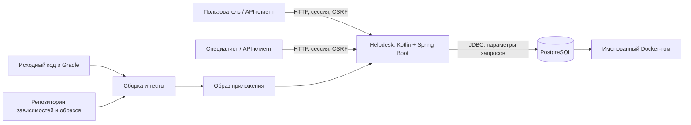

# Проект: Helpdesk, выпуск v1.0.0

Helpdesk — учебный сервис обращений. Этот документ описывает подготовку одного выпуска `v1.0.0` на протяжении курса: от выбора продукта и методологии до проверок и решения о выпуске.

На ЭК1 определены границы продукта, риски, основная рамка NIST SSDF, существенные разрывы, целевой процесс безопасной разработки и направления проверок. Эта основа сохранена в разделах 1–5 и уточнена по результатам дальнейшей работы.

На ЭК2 выполнены запланированные проверки доступа, сессий, зависимостей и среды запуска, добавлено ограничение попыток входа и обновлены компоненты. Разделы 6–11 содержат результаты, их разбор, сравнение до и после улучшения, решение о выпуске и программу развития. Итоговое решение — выпускать с условиями: один локальный экземпляр и только искусственные данные.

Обозначения связывают части проекта: R — риск, A — практика, G — пробел, Q — контрольная точка, M — метод, F — результат проверки. Идентификаторы рисков, практик, разрывов и методов сохранены между этапами, чтобы сопоставлять исходный план с результатами. Тег `ek1` хранит версию документа, представленную на промежуточной экспертизе.

## 1. Паспорт проекта

**Участник:** [VladislavKabakov](https://github.com/VladislavKabakov).

**Название проекта и команды:** Helpdesk.

**Формат:** индивидуальное выполнение.

**Продукт:** серверный сервис для регистрации и решения обращений пользователей.

**Выпуск:** `v1.0.0` для локальной учебной среды; версия приложения `1.0.0`. Кандидат кода — commit `5ac6a7f6405a50af0d80e20f091716154c584d09`; последующие изменения комплекта относятся к документации, её проверке и свидетельствам. Полный комплект фиксирует тег `ek2`.

**Исходное состояние (baseline):** commit `f58554c3ef048ac3652e2c265c48a76c30e78e91`, tag `baseline-ek1`; каркас до дальнейших улучшений для ЭК2. Проверка: `git rev-parse baseline-ek1^{commit}`.

**Срезы:** `ek1` — прежняя сдача; `774dedd1d92e786e39019fbe5188f12ef15e365c` — непосредственная исходная версия для сравнения ЭК2. Для новой сдачи архив формируется из `ek2`. ФИО и учебная почта передаются через ЭИОС.

**Репозиторий:** [VladislavKabakov/helpdesk](https://github.com/VladislavKabakov/helpdesk), публичный.

### Контекст и пользователи

Продукт рассматривается как небольшой внутренний сервис поддержки учебной организации. Контекст условный: реального заказчика, производственной среды и данных сотрудников нет.

Описание процесса взаимодействия с системой:

1. Пользователь сообщает о проблеме, просматривает свои обращения и ответы.
2. Специалист выбирает обращение из очереди, принимает его в работу, обсуждает проблему и записывает решение. Внутренние заметки нужны для служебной диагностики и не предназначены пользователю. При повторном открытии обращение возвращается в очередь, а следующий специалист получает всю историю.

Для пользователя важны конфиденциальность переписки и достоверный статус решения. Для специалиста — корректное назначение и возможность сохранить внутренние сведения. Регистрация, самостоятельная смена пароля и управление персоналом пока не входят в продукт: четыре искусственные учётные записи создаются в отдельном демонстрационном режиме.

### Границы

В проект входят REST API, сессии и проверка полномочий, PostgreSQL, миграции Flyway, зависимости Gradle, Dockerfile, Compose, тесты, инструкция запуска и конфигурация GitHub Actions. Один выпуск включает согласованное состояние исходного кода, схемы БД, образа приложения и документации.

За границами остаются браузерный интерфейс, почта, загрузка файлов, корпоративный вход, несколько организаций, платёжные операции, публичный сервер и инфраструктура GitHub как сервиса. Настройки собственного репозитория и workflow остаются в области проектирования процесса. Реальные персональные данные и производственные секреты не используются.

Ограничение оправдано: текстовые обращения уже дают законченный процесс и существенные задачи защиты. Вложения и внешние интеграции увеличили бы объём анализа без необходимости для выбранного выпуска. Подробный [контракт API](docs/api.md) задаёт действия ролей и переходы статусов.

### Компоненты, взаимодействия и границы доверия

| Граница | Что проходит | Почему существенна |
| --- | --- | --- |
| Клиент → API | Пароль, cookie, ID обращения, текст и команды | Клиент полностью недоверенный; ID и заявленная роль не являются разрешением |
| Пользователь → данные другого пользователя | Попытка доступа через ID и списки | Должна сохраняться изоляция обращений при каждом чтении и изменении |
| Пользователь → полномочия специалиста | Назначение, решение, внутренние заметки | Требуются проверки операции, объекта и доступных полей |
| API → PostgreSQL | Параметризованные запросы и миграции | Нельзя превращать входной текст в SQL; полномочия соединения ограничивают последствия ошибки |
| Код и внешние компоненты → образ | Зависимости, плагины, базовые образы | Изменение состава сборки влияет на доверие к проверенному выпуску |
| Локальная среда → GitHub | Код, конфигурация, результаты проверок | `.env` и другие секреты не должны попасть в историю или артефакты CI |

Loopback ограничивает доступ к API с сети, но не делает клиент доверенным. Пользователь компьютера с доступом к Docker считается администратором среды; защита от такого администратора не обещается.

### Активы и существенные риски

Ниже перечислены сценарии риска, а не заявления о найденных уязвимостях. Приоритет определяется возможностью нарушить главное обещание продукта и ущербом в заявленной среде. Для сетевой публикации оценку потребуется пересмотреть.

| ID | Актив и сценарий | Последствие и приоритет | Действующая мера / проверка |
| --- | --- | --- | --- |
| R01 | Текст и история чужого обращения: подстановка ID или обход через список | Раскрытие переписки; высокий | Проверка владельца в сервисе и фильтрация выборки; M1, M2 |
| R02 | Внутренняя заметка: выдача вместе с публичной перепиской | Раскрытие служебных сведений; высокий | Фильтрация до пагинации; M1, M2 |
| R03 | Назначение и статус: пользователь вызывает операцию специалиста или подменяет поля | Ложное решение, изменение чужой работы; высокий | Отдельные команды, роль из БД, неизвестные JSON-поля запрещены; M1, M2 |
| R04 | Сессия: поддельный межсайтовый запрос (CSRF), фиксация сессии, повторное использование после выхода | Действия от имени другого лица; высокий | CSRF, смена ID при входе, завершение сессии, cookie; M2, M5 |
| R05 | Учётная запись: подбор пароля или офлайн-перебор хэша | Захват полномочий; высокий для публичной среды | BCrypt cost 12; теперь 10 попыток входа в минуту с одного адреса; G03, M5 |
| R06 | База: SQL-инъекция через входной текст | Чтение или изменение данных; высокий | Параметры JDBC, статические имена колонок; M2, M3 |
| R07 | Право назначения: два специалиста принимают одно обращение | Противоречивый исполнитель и аудит; средний | Блокировка строки и транзакция; M2 |
| R08 | Журналы и ошибки: пароль, cookie или текст в диагностике | Вторичный канал утечки; высокий | Ограниченный ответ ошибки и журнал действий без содержания; M3, M5 |
| R09 | Доступность: большие тела, множество запросов и сессий | Исчерпание памяти или соединений; средний локально | Лимит JSON и страниц, ограниченный пул и память; остаются G03, M5 |
| R10 | Зависимости и образ: известная уязвимость или подмена компонента | Компрометация приложения/сборки; высокий | Lock-файл, SHA дистрибутива, digest образов, SBOM и разбор SCA; G02, M4 |
| R11 | Секреты БД: публикация `.env` или попадание в слой образа | Доступ к данным; высокий | Случайные локальные секреты, исключения Git/Docker; M3, M6 |
| R12 | Данные и аудит: ошибка приложения с правами владельца таблиц | Потеря данных, изменение истории; высокий | Нет superuser, но DDL доступен для Flyway; G04, G05, M6 |
| R13 | Образ выпуска: опубликован другой код, чем проверен | Недостоверное основание выпуска; высокий | Фиксация версии и проверок; правила Q3–Q4, M7 |

### Доступные материалы и ограничения

Доступны весь исходный код, миграции, конфигурация, прямые и транзитивные зависимости, автоматические тесты и Docker-среда. Исходное состояние фиксируется локально в Git. Приложение можно изменить и повторить проверку самостоятельно; лицензии внешних сервисов и закрытые рабочие материалы не нужны.

Для ЭК1 непрерывная интеграция (CI) проверена фактическим запуском GitHub Actions: сборка, тесты и проверка документов прошли. Этот запуск не подтверждает кандидат ЭК2. Результаты и ссылка на запуск собраны в [evidence/verification.md](evidence/verification.md); они не распространяются на неизвестную производственную среду. Пример исходного Kotlin/Gradle-проекта использован только как ориентир сборки; его данные и конфигурационные секреты не переносились.

Выполнимость обеспечивается небольшим числом сущностей, единой БД, локальным запуском и воспроизводимыми сценариями. Для ЭК2 после исходной проверки выбрано ограничение попыток входа и подтверждено сравнением до/после; разделение полномочий БД оставлено в программе развития.

## 2. Методологическая основа

### Требования к основе и сравнение кандидатов

Нужна рамка, охватывающая путь от требований до выпуска и обработки проблем, допускающая одного исполнителя, не зависящая от языка и не требующая недоступной производственной инфраструктуры. Положения должны превращаться в конкретные действия, результат которых можно проверить. Версии документов указаны в таблице; сравнение опирается на [материалы курса](https://github.com/hse-rbpo-master-2026/course/blob/5ce5fdf4ba4bb32ac62d1b9c6728f3a6d8fa6884/resources.md).

| Кандидат | Назначение и применимость | Адаптация и ограничения | Доступ и решение |
| --- | --- | --- | --- |
| **NIST SP 800-218, SSDF 1.1** | Практики безопасной разработки на всём жизненном цикле; подходят небольшому API | Ответственность совмещается, выбираются семь задач; нет готового локального процесса и детальных правил доступа | Открыт полный официальный текст; **основная рамка** |
| **OWASP SAMM 2** | Оценка зрелости и программа развития практик | Для нового продукта почти нет истории, чтобы обосновать уровни; полноценная оценка организации несоразмерна | Открытая модель; сравнили, **не включаем** в профиль |
| **ГОСТ Р 56939-2024** | Требования к процессам разработки безопасного ПО; применим при соответствующем контексте | Потребуется отбор процессов и упрощение ролей; обязательное применение заказчиком для данного учебного продукта не установлено | Для сравнения использованы L02 и карточка из курса; полный текст в этом комплекте не воспроизводится; **не выбран** |
| **ISO/IEC 27034-1:2011** | Управление безопасностью приложения в организации, включая отношения сторон | Сложный организационный контекст отсутствует; общая рамка требует значительной конкретизации | Официальная карточка и L03 доступны, полный текст не заявляется изученным; **не выбран** |
| **IEC 62443-4-1:2018** | Жизненный цикл продукта для промышленной автоматизации | Helpdesk не промышленный компонент; отраслевые требования не дают полезного основного каркаса | Официальная карточка и L03 доступны; **не выбран** |

Дополнительный источник — [OWASP ASVS 5.0.0](https://github.com/OWASP/ASVS/tree/v5.0.0), только для конкретизации технических требований. Используем 8.1.1–8.1.2 (документирование доступа к операциям, объектам и полям), 8.2.1–8.2.3 (его реализация), 8.3.1 (проверка в доверенном сервисном слое) и 6.3.1 (защита от перебора). Это выборочные требования; соответствие полному уровню ASVS не заявляется. Сам ASVS не заменяет процессную рамку SSDF.

### Адаптация семи задач SSDF

Оригинальные формулировки проверены по [NIST SP 800-218](https://doi.org/10.6028/NIST.SP.800-218). Ниже дано краткое изложение смысла и наше локальное решение. Указанные инструменты и интервалы проверки выбраны для Helpdesk, а не предписаны NIST.

**A01 — PO.1.2: определить и поддерживать требования безопасности к разрабатываемому ПО.** Применимо полностью в границах продукта. Для каждого изменения определяются затронутые риски R01–R13 и при необходимости обновляются правила [API](docs/api.md). Результат — конкретное разрешённое/запрещённое поведение и соответствующий тест или план. Проверка: для чтения, записи и переходов состояний можно определить действующее лицо, объект и ожидаемый ответ. Исключены требования к отсутствующим почте, файлам и внешнему входу; при их добавлении профиль пересматривается.

**A02 — PO.2.1: определить роли и обязанности на всём жизненном цикле.** Применимо частично: один студент выполняет разработку, самопроверку и подготовку выпуска. Результат — распределение функций и процедура самостоятельной проверки в разделе 4. Проверка: для каждой контрольной точки назван ответственный и сохраняемый результат. При индивидуальной работе независимой проверки нет; это ограничение учтено в G07. Полученные замечания преподавателя сохраняются вместе с исправлениями.

**A03 — PO.4.1: определить критерии проверок безопасности и отслеживать их в жизненном цикле.** Применимо полностью. Условия перехода между этапами заданы в Q1–Q4; результаты обязательных проверок и отклонения сохраняются. Результат — протокол с версией, исходом и ссылками. Проверка: провал контроля доступа блокирует выпуск; отсутствие запуска не считается успешным тестом. Исключения имеют основание, срок и компенсирующую меру.

**A04 — PS.1.1: хранить код и конфигурации с минимально необходимыми правами.** Применимо к репозиторию и сборке. Код хранится в Git, локальные секреты исключены из публикации, права workflow ограничены чтением, сторонние actions закреплены коммитами. Перед публикацией проверяются история и права репозитория. Результат — история изменений, конфигурация CI и проверка комплектности. Проверка: секреты исключены, изменения прослеживаются, доступ на запись предоставлен только необходимым субъектам. Публичное чтение исходников разрешено; защита ветки от обхода проверок не заявляется.

**A05 — PW.4.4: проверять сторонние компоненты на соответствие требованиям проекта в течение их жизненного цикла.** Применимо полностью для используемых компонентов. Версии зависимостей и образы зафиксированы. Перед выпуском формируются перечень компонентов (SBOM) и анализ известных уязвимостей. Результат — отчёт с датой базы уязвимостей и решениями по находкам. Проверка: отчёт относится к нужной версии, прямые и транзитивные зависимости сопоставлены с поставкой. Отчёт ЭК2 приведён в разделе 6. Полный аудит исходников всех сторонних библиотек выходит за границы работы.

**A06 — PW.8.2: определить область тестирования, провести его и разобрать обнаруженные проблемы.** Применимо полностью. Сценарии связаны с рисками: проверяются разрешённые и запрещённые действия, а также одновременные запросы на PostgreSQL. Проверка: нарушение ожидаемого поведения приводит к падению соответствующего теста. Результат — исходники тестов, XML и интерпретация охвата. Нагрузочная устойчивость и все возможные последовательности запросов не следуют из прохождения небольшой регрессии.

**A07 — RV.2.1: собрать сведения о риске для выбора реакции на уязвимость.** Применимо полностью как правило обработки. Для находки сохраняются версия, сценарий, влияние, применимость, приоритет и решение. После исправления повторяются исходный сценарий и тесты связанных функций. Результат — запись о разборе с проверяемым основанием. Проверка: сырой вывод сканера не приравнен к подтверждённой уязвимости, исключение не скрывает блокирующую проблему.

Эти семь задач охватывают требования, ответственность, защиту материалов, компоненты, проверки и реакцию. Полное соответствие SSDF не заявляется. При анализе текущего состояния особенно проверяются воспроизводимость, права БД и отсутствие контроля частоты входа. На ЭК2 профиль уточнён по результатам реальных запусков. Использованы опубликованные материалы курса L01–L05 и S01–S06, полный шаблон и рубрика ЭК2; отсутствующие в репозитории L06–L09 и S07–S09 изученными не объявляются.

## 3. Текущее состояние

### Что было до ЭК2

Каркас создан для курса с помощью ИИ. В `774dedd` уже работали правила доступа, CSRF, BCrypt, транзакции, миграции и контейнерный запуск. Повторный запуск этой версии 15 октября дал **28 успешных тестов**, без ошибок и пропусков: [исходный результат](evidence/ek2/tests-before.json). Ранее прошедший [GitHub Actions](evidence/github-actions.json) относится к ЭК1, а не к текущему кандидату.

История позволяет проследить исходный каркас `f58554c`, доработку описания и запуска `2d7627f`, комплект ЭК1 и начало ЭК2 `774dedd`. Производственных выпусков и длительной истории командной разработки нет. Наличие workflow не доказывает защиту ветки от обхода или регулярное выполнение всех проверок.

### Существенные разрывы и их состояние после апробации

G01–G07 определены при анализе текущего состояния на ЭК1. В таблице сохранены эти разрывы и показано, какие из них закрыты или уменьшены на ЭК2, а какие остаются ограничениями выпуска.

| ID | Наблюдение и основание | Значимость и результат ЭК2 |
| --- | --- | --- |
| G01 | Для ЭК1 опубликован репозиторий и выполнен CI; обязательность проверок настройками ветки не обеспечена | Публикация ЭК1 подтверждена. Для нового кандидата есть чистая локальная сборка; новый удалённый CI до push не заявляется пройденным |
| G02 | До ЭК2 были версии в lock-файле, но не было SBOM и отчёта SCA | Высокий приоритет: невозможно обосновать состав поставки. Теперь есть перечень фактически упакованных JAR, анализ Java и ОС, триаж и обновления; F02–F05 |
| G03 | 12 неправильных паролей подряд дали 12 ответов 401, затем правильный пароль — 204 | Подтверждён пробел защиты от перебора, особенно существенный перед сетевым запуском. Теперь 11-я попытка даёт 429. Снижение риска частичное: число сессий и распределённые запросы не ограничены; F01 |
| G04 | Роль `helpdesk` без superuser, но владеет таблицами и выполняет Flyway | Средний риск локально: ошибка приложения может изменить схему. На ЭК2 проверено, разделение ролей не реализовано; F07 |
| G05 | Том сохраняет данные при перезапуске, проверенной резервной копии нет | Средний риск потери данных. Проверено сохранение и повторная миграция, но не восстановление из копии; F08 |
| G06 | Аудит успешных действий находится в той же БД; отказов входа и внешней защиты журнала нет | Средний риск пропустить атаку и потерять следы. Исключено содержимое переписки из аудита; полноценное наблюдение остаётся в плане |
| G07 | Разработку и проверку выполняет один участник с ИИ | Независимого review нет. Отдельный просмотр кода и негативные тесты уменьшают вероятность ошибки, но не заменяют независимость |

Свидетельства G02–G06: [протокол](evidence/ek2/verification.md), [проверка среды](evidence/ek2/runtime.json), [разбор находок](evidence/ek2/triage.json). Не каждый пробел является эксплуатируемой уязвимостью: отсутствие резервирования — риск потери данных, а совпадение версии с CVE ещё требует анализа условий эксплуатации.

### Реальный путь изменения на ЭК2

Сначала воспроизведены исходные тесты и серия входов; затем выбрано улучшение G03. Внесены ограничитель, проверки границ окна и конкурентных запросов. Отдельно сформирован состав поставки и обновлены компоненты по результатам SCA. Изменение `5ac6a7f` содержит код, конфигурации, сценарии и тесты; повторные проверки привязаны к нему и хэшам образа/JAR. Это один наблюдаемый цикл процесса, а не доказанная зрелость организации.

## 4. Целевой Secure SDLC

Жизненный цикл безопасной разработки (Secure SDLC) для Helpdesk состоит из коротких повторяемых действий. За разработку, самопроверку и решение о выпуске отвечает единственный участник проекта — [VladislavKabakov](https://github.com/VladislavKabakov). В таблице перечислены его функции и результаты каждого этапа; независимая проверка отсутствует (G07).

### Практики и ответственность

| Когда | Обязательное действие | Функция и результат | Основание |
| --- | --- | --- | --- |
| До изменения | Уточнить затронутый сценарий риска, правила доступа и границы | Определение требований; обновлённое правило и критерий приёмки | A01, R01–R13 |
| При реализации | Использовать DTO с разрешёнными полями, параметризованные запросы, транзакции и стандартные механизмы безопасности | Разработка; код, миграция и тест | A01, A06 |
| После изменения | Просмотреть diff отдельным проходом; проверить чтение, запись, ошибки и побочные пути | Самопроверка; замечания и исправления с коммитами | A02, G07 |
| До включения в основную ветку | Выполнить сборку, регрессию и проверку секретов; проверить соответствие текста фактическому коду | Самопроверка и CI; результат запуска для конкретного состояния | A03, A04, A06 |
| При обновлении зависимостей и перед выпуском | Сопоставить компоненты, SBOM и результаты анализа; разобрать существенные находки | Сопровождение; отчёт и решения | A05, G02 |
| Перед выпуском | Проверить комплект и остаточный риск, выбрать выпуск / выпуск с условиями / отсрочку | Решение о выпуске; решение по конкретному кандидату | A03, R13 |
| После сообщения о проблеме | Проверить применимость, оценить ущерб, исправить и повторить проверку | Сопровождение; запись триажа и регрессия | A07 |

При изменении аутентификации обязательны проверки сессий и CSRF; при изменении SQL — проверки данных и транзакций; при изменении образа — повторный запуск Compose. Добавление файлов, HTML-интерфейса или внешнего API требует пересмотра рисков до реализации. Глубина остальных проверок зависит от того, какие функции затронуты изменением.

### Контрольные точки

**Q1 — пригодность объекта и требований.** Перед началом анализа есть конкретная версия, запуск, правила двух ролей и разрешённые учебные данные. Можно изменить приложение и повторить проверку. Если объект или данные недоступны, работа с таким объектом не принимается; границы уменьшаются.

**Q2 — готовность изменения.** Перед включением изменения проходят сборка и автоматические тесты. Для изменения доступа нужен как минимум разрешённый и запрещённый сценарий. Отдельно проверяются diff и отсутствие секретов в Git и контексте Docker. Ошибка теста, отсутствие зависимости или пропущенный Docker-тест означает непрохождение точки, а не «нет находок».

**Q3 — готовность кандидата выпуска.** Для `v1.0.0` обязательны регрессия, чистый запуск, миграции, разбор зависимостей и образа, состав компонентов и существенные результаты M1–M7. Отсутствие результатов проверки защиты от R01–R04, утечка секрета, неисправная миграция или применимая критическая уязвимость блокируют выпуск. На ЭК2 прохождение этой точки рассматривается по фактическим результатам раздела 9. Неизученная находка не становится автоматически ложным срабатыванием.

**Q4 — связь решения с поставкой.** Перед созданием тега выпуска сверяются commit, конфигурация, схема БД, хэш образа, результаты проверок и условия использования. Выпускается именно проверенный кандидат. При изменении кода или зависимостей после проверки затронутые проверки повторяются. `ek1` — отметка учебной сдачи, а не разрешение на публичную эксплуатацию.

### Исключения, принятие риска и эскалация

Исключение записывается в `project.md` или issue со ссылкой на версию и свидетельство. Обязательны: правило, причина, затронутый риск, компенсирующая мера, ответственный, срок пересмотра и решение.

**E01, действующее ограничение каркаса:** HTTP без TLS допустим только на `127.0.0.1`, с искусственными данными и локальными случайными паролями. Для `v1.0.0` ограничение сохранено; его условия, владелец и срок пересмотра указаны в разделе 9. Мера снижает риск передачи сессии по сети, но не защищает от администратора компьютера.

**E02, процессное ограничение:** индивидуальный формат не обеспечивает независимый review. Часть ошибок помогают выявить отдельный проход самопроверки и тесты с разными пользователями, но независимого взгляда они не заменяют.

Нарушение изоляции чужих обращений, раскрытие внутренних заметок и обход полномочий не принимаются как исключения даже для учебной демонстрации. Вопросы объёма и формата работы уточняются у преподавателя. Техническая проблема сначала воспроизводится и описывается; после оценки последствий принимается решение об исправлении или отсрочке выпуска.

### Проверка схемы и действия после выпуска

Пример применения процесса — изменение выдачи внутренних заметок. Требование A01: пользователь не должен видеть служебную переписку. После изменения проверяются ответы пользователя и назначенного специалиста; в Q2 сохраняются diff и результаты тестов. Если нужного теста нет или он не запустился, включение изменения откладывается до проверки. Перед `v1.0.0` в Q3–Q4 рассматривается весь комплект, включая результаты по остальным существенным рискам.

При проверке схемы уточнены канал сообщения о проблемах после выпуска и границы выводов о текущем состоянии (раздел 3).

Сообщения об учебном продукте без секретов и реальных данных принимаются через Issues репозитория. Для сообщения устанавливаются затронутый commit, способ воспроизведения на учебных данных, влияние и следующее действие. При подтверждении нарушения доступа рекомендация использовать затронутую версию приостанавливается до исправления. Исправление проходит исходный сценарий и регрессию; сохраняются версии до и после. После разбора причины при необходимости дополняется правило A01 или сценарий M2. Неподтверждённое сообщение закрывается с основанием.

При недостаточных результатах проверок выпуск откладывается. Консультация преподавателя помогает уточнить объём работы; решение о технической готовности остаётся ответственностью участника проекта.

### Что реализовано в рамках курса

К ЭК1 подготовлены приложение, миграции, CI-конфигурация, исходные проверки доступа и план безопасной разработки. На ЭК2 этот план применён: выполнены анализ состава, триаж, улучшение защиты входа, сравнение до/после и проверка чистого запуска. Разделение ролей БД, резервирование и внешнее наблюдение перенесены в программу развития с условиями, при которых они станут обязательными.

## 5. Технологический профиль

Направления M1–M7 выбраны на ЭК1 по рискам продукта. К ЭК2 уточнены инструменты и область каждого метода; их фактическое применение описано в разделе 6, выводы — в разделе 7.

Основной исполнитель и ответственный по M1–M7 — VladislavKabakov, индивидуальный формат, с использованием Codex (раздел 12). Проверка партнёром неприменима; вместо неё результаты повторяются отдельным запуском и сопоставляются с кодом. Это самопроверка, не независимый аудит.

| Метод | Риск, цель и область | Когда и чем проверяем | Результат и проверка результата | Ограничение |
| --- | --- | --- | --- | --- |
| M1. Правила доступа | R01–R03: для каждой операции определить роль, объект, доступные поля | До изменения; контракт API и ручной анализ Kotlin-кода кандидата | Матрица в API, сопоставление с тестами и сервисным слоем | Модель двух ролей; полномочия администратора отсутствуют |
| M2. Автоматическая регрессия | R01–R07: разрешённые и запрещённые действия, переходы и конкурентное назначение | При изменении и перед выпуском; Gradle 8.14.3, JUnit 5.12.2, Spring Test 6.2.19, Testcontainers 1.21.4, PostgreSQL 17.11 | Имена и результаты тестов; повтор из чистой копии; отдельные unit-тесты ограничителя | MockMvc не проверяет реальную сеть; проверка гонки назначения проходит через сервис, не HTTP |
| M3. Код и секреты | R06, R08, R11: проследить ввод до SQL/ответа/журнала, найти возможные секреты | До фиксации и публикации; просмотр исходников, Gitleaks 8.30.1 | Область ручного просмотра и отчёт; ложное срабатывание проверено пересчётом SHA-256 | Полного SAST нет; Gitleaks проверяет шаблоны секретов, а не всю безопасность кода |
| M4. Состав поставки | R10, R13: знать упакованные компоненты и известные проблемы | При обновлениях и перед выпуском; CycloneDX Gradle 3.5.1, собственная сверка JAR, Trivy 0.76.0 | SBOM CycloneDX 1.6, хэши библиотек, отчёты Java и ОС, отдельный триаж | База известных уязвимостей; плагины сборки, тестовые зависимости, хост и JDK как отдельный продукт не покрыты полностью |
| M5. HTTP-проверки | R04, R05, R08, R09: реальное поведение сессии, CSRF, ошибок и лимитов | На работающем кандидате; Python 3.13.0, стандартный HTTP-клиент | 12 ограниченных сценариев; серия входов до/после и smoke | Нет браузерного интерфейса, публичного TLS, нагрузочного теста и доказательства стойкости ко всем видам DoS |
| M6. Среда и миграции | R09, R11, R12: минимальные права, автоматическая схема, сохранение данных | Сборка и выпуск; Docker/Compose, Flyway 11.7.2 | Выбранные параметры контейнеров без секретов; новый том и повторный запуск | Нет проверки хоста и восстановления резервной копии |
| M7. Воспроизводимость | R13: другой запуск проверяет ту же версию исходников | Перед фиксацией комплекта; Git, Wrapper, README | Чистая копия, новый `.env`, отдельный том, хэши исходников и образа | Кэш и интернет используются; побитовая идентичность сборки на разных платформах не обещается |

Версии и существенные команды записаны в [протоколе](evidence/ek2/verification.md). Тесты выбирались по рискам, а не ради числа инструментов. Автоматический поиск XSS в отсутствующем интерфейсе или сканирование чужих серверов здесь не дают нужного результата.

## 6. Практическая апробация

Проверки выполнены 15 октября 2026 года на macOS/ARM64 с Colima. Базовое состояние — `774dedd`, кандидат кода — `5ac6a7f`. Полные безопасные результаты находятся в `evidence/ek2/`; старые файлы в корне `evidence/` относятся к ЭК1.

| Метод | Выполненное действие | Существенный результат |
| --- | --- | --- |
| M1 | Сопоставлены операции API, роли, владение и назначение с `TicketService`; отдельно рассмотрены очередь и смена специалиста | Матрица непротиворечива в проверенных сценариях; [карта проверки кода](evidence/ek2/verification.md) |
| M2 | `./gradlew clean test bootJar cyclonedxBom --no-daemon`; перед запуском доступен Docker | До изменения 28, после 37 тестов без ошибок и пропусков; [до](evidence/ek2/tests-before.json), [после](evidence/ek2/tests-after.json) |
| M3 | Просмотр SQL, DTO, фильтров, ошибок и аудита; `gitleaks git . --redact=100 ...` и проверка публикуемых файлов | В истории один сигнал, в снимке два; все относятся к хэшу исходника; [отчёт](evidence/ek2/secrets-history.json), [проверка](evidence/ek2/secrets-triage.json) |
| M4 | SBOM сформирован и сверен с `BOOT-INF/lib` JAR; Java и ОС сканированы отдельно одной базой Trivy | [Состав поставки](evidence/ek2/sbom-runtime.cdx.json), [Java](evidence/ek2/dependencies-after.json), [образ приложения](evidence/ek2/image-after.json), [PostgreSQL](evidence/ek2/postgres-before.json) |
| M5 | `login_probe.py`, `http_security_probe.py` и `smoke.py` на loopback; только искусственные учётные записи | [Вход до](evidence/ek2/login-before.json), [вход после](evidence/ek2/login-after.json), [HTTP](evidence/ek2/http-security.json), [smoke](evidence/ek2/smoke.txt) |
| M6 | Выборочный `docker inspect`, запросы прав роли и истории Flyway; создание нового тома и перезапуск | [Среда](evidence/ek2/runtime.json), [чистый запуск](evidence/ek2/clean-checkout.json) |
| M7 | Локальное клонирование зафиксированного кода без рабочего `.env`, выполнение README на порту 18080 | [Чистая копия](evidence/ek2/clean-checkout.json), [связь исходников и артефактов](evidence/ek2/source-manifest.json) |

Для повторения M4 нужны Trivy 0.76.0 и Gitleaks 8.30.1 из официальных релизов. Команды, версии базы и правила чтения отчётов даны в протоколе. Обычный exit code 0 Trivy означает завершение анализа, а не отсутствие уязвимостей: в отчётах сохранены и оставшиеся сигналы. Для независимого повтора база будет новее, поэтому число CVE может измениться.

Первый запуск анализа образа не завершился из-за отсутствующей Java-базы Trivy. Его результат не использован как успешный: анализ разделён на SBOM библиотек Java и пакеты ОС. Первоначальный Gradle SBOM содержал метаданные стартеров, но не добавленный Boot инструмент распаковки. Поэтому состав дополнительно сопоставлен с JAR: каждая упакованная библиотека имеет координаты и SHA-256. В отчёте кандидата 50 таких библиотек; зависимости сборки и тестирования туда не входят.

Не проверены 15 минут естественного истечения сессии, восстановление резервной копии, распределённая атака, производственная инфраструктура и внешний TLS. Тайм-аут сессии подтверждён конфигурацией; выход и непригодность старой cookie проверены реальным HTTP. Эти границы не заменяются формулировкой «всё безопасно».

## 7. Результаты и триаж

Единица SCA — пара «компонент + идентификатор уязвимости». Одна CVE в двух пакетах считается двумя сигналами, а не двумя независимыми атаками. [Машиночитаемый разбор](evidence/ek2/triage.json) сохраняет исходную серьёзность сканера и решение отдельно.

| ID | Вывод и основание | Влияние на выпуск |
| --- | --- | --- |
| F01 | **Подтверждён:** отсутствовал прикладной лимит входа — 12 ответов 401 в исходной версии. После изменения 10 ответов 401, далее 429, восстановление после окна — 204 | Исправлен в пределах одного процесса и транспортного адреса; распределённый перебор и сессии остаются риском |
| F02 | **Подтверждён состав с известными проблемами:** исходные версии Jackson, Tomcat, pgJDBC и Log4j сопоставлены с SCA. Это не доказательство эксплуатации каждой CVE в Helpdesk | Обновлены совместимые версии. Из 18 сигналов Java устранены 16; два оставшихся разобраны в F03 |
| F03 | **Неприменимо к текущим функциям:** CVE-2026-47884 требует XsltView и разрешения имени представления; CVE-2026-47890 — SSE с фрагментами представлений. У нас только REST-контроллеры с JSON, нет XSLT, SSE, шаблонов и таких настроек | Библиотека всё ещё в затронутой ветке. Не подавляем сигналы; добавление представлений требует повторного решения. У Spring указаны Medium/Low, у текущей базы сканера Critical — сохраняем расхождение, а не усредняем его |
| F04 | **Подтверждён состав:** в исходном образе есть уязвимые системные пакеты. Обновление Temurin и трёх пакетов устраняет исправляемые сигналы, включая OpenSSL | Оставшиеся Low/Medium без доступного исправления требуют дальнейшего анализа применимости; E03. Отсутствие прямого вызова пакета само по себе не доказывает неприменимость |
| F05 | **Требует дополнительной проверки:** в закреплённом PostgreSQL найден zlib CVE-2026-85091, Medium. Тот же digest остаётся актуальным официальным `17-alpine` на момент проверки | Внешний порт БД закрыт, данные искусственные. Принимается временно только в локальной среде; E03, обновление/разбор до реальных данных |
| F06 | **Ложное срабатывание:** Gitleaks распознал значение после `ApiErrors.kt` как generic-api-key; пересчёт даёт тот же SHA-256 исходника. В текущем снимке два вхождения в старом и новом манифестах | Не является ключом доступа; удалять историю и менять пароли из-за этого сигнала не требуется |
| F07 | **Подтверждён:** `helpdesk` не superuser, но владеет таблицами | G04 остаётся; для ценных данных нужен отдельный пользователь миграции |
| F08 | **Подтверждён ограниченный результат:** новый том и миграция работают, данные сохраняются после перезапуска; восстановления из копии нет | G05 остаётся; том не объявляется резервной копией |
| F09 | **Подтверждены проверенные свойства:** в тестах не обнаружены чтение чужого обращения, выдача внутренних заметок пользователю, двойное назначение и обход CSRF | Основание для локальной демонстрации; конечный набор сценариев не доказывает отсутствие всех ошибок |

Основания F03: [объявление Spring об XsltView](https://spring.io/security/cve-2026-47884/), [объявление Spring о SSE](https://spring.io/security/cve-2026-47890/), [контроллеры](src/main/kotlin/ru/course/helpdesk/TicketController.kt), [настройки](src/main/resources/application.yml). Исправленная открытая ветка Spring 7 требует отдельной миграции стека; менять основную платформу ради отсутствующих функций в этом выпуске не выбрано. Решение действует только для данного кода.

Для OpenSSL сверено [USN-8847-1](https://ubuntu.com/security/notices/USN-8847-1). Условия Tomcat сверены с [официальными объявлениями](https://tomcat.apache.org/security-10.html): приложение использует Spring Security, не контейнерные Realm/FORM/DIGEST. Однако доступное обновление принято, чтобы убрать устаревший компонент и не зависеть от постоянства конфигурации.

## 8. Улучшение и повторная проверка

Основное улучшение — **ограничение попыток входа**, риск R05 и разрыв G03. Оно выбрано потому, что затрагивает имеющийся внешний вход, воспроизводится небольшой серией запросов и имеет проверяемый результат. Специально внедрять уязвимость для демонстрации не потребовалось: исходный каркас честно фиксировал отсутствие лимита.

Изменение: [commit 5ac6a7f](https://github.com/VladislavKabakov/helpdesk/commit/5ac6a7f6405a50af0d80e20f091716154c584d09), [ограничитель](src/main/kotlin/ru/course/helpdesk/LoginAttemptLimiter.kt), [интеграционные тесты](src/test/kotlin/ru/course/helpdesk/HelpdeskIntegrationTest.kt) и [unit-тесты](src/test/kotlin/ru/course/helpdesk/LoginAttemptLimiterTest.kt). Ссылка на коммит станет доступна после публикации; локально он уже зафиксирован.

Правило: 10 запросов входа за 60 секунд для одного транспортного адреса; считаются успешные и неуспешные попытки с валидным CSRF. Следующая получает 429 и `Retry-After` до проверки пароля. Неверный CSRF даёт 403 раньше и не расходует этот лимит. Окно не продлевается отказами; часы монотонные. Заголовкам `Forwarded`/`X-Forwarded-For` не доверяем, поскольку доверенного прокси нет.

Хранилище ограничено 10 000 адресов. Просроченные записи очищаются; при заполнении активные записи не вытесняются ради новых, иначе смена адресов позволяла бы обходить лимит. Решение синхронизировано: конкурентные запросы не получают больше 10 разрешений в одном окне. Это фиксированное окно, поэтому у его границы возможен короткий всплеск; полноценным сетевым ограничителем механизм не является.

| Проверка | До | После |
| --- | --- | --- |
| 12 неверных входов с одного адреса | 12 × 401 | 10 × 401, 2 × 429 |
| Подмена X-Forwarded-For после лимита | Механизма ограничения не было | 429 |
| Правильный пароль | 204 сразу после серии | 204 после истечения указанного окна |
| Основная регрессия | 28 успешных тестов | 37 успешных тестов, включая прежние сценарии |
| Соседние функции | Исходный smoke проходит | Повторно проходят CSRF, смена ID, выход, скрытие заметок и смена специалиста |

Сравнение использует один сценарий [login_probe.py](scripts/login_probe.py), один адрес и свежий процесс. Повтор «до» делается на `774dedd`, «после» — на кандидате; подробные команды в протоколе. Счётчик сбрасывается при перезапуске; общий NAT даёт общий бюджет; ограничение по имени пользователя не вводилось, чтобы посторонний не мог бессрочно заблокировать чужую учётную запись. Несколько экземпляров и прокси требуют другого проектирования.

Дополнительное улучшение — воспроизводимый анализ состава и обновление Java/системных пакетов. Одна база Trivy использована до и после; полный разбор сохранён. Ограничитель не исправляет проблемы зависимостей, а обновления не доказывают корректность прав — это разные результаты.

В индивидуальной работе второго участника нет. Инженерная подготовка и запуски выполнены с помощью Codex; личный вклад и ограничения описаны на [индивидуальной странице](individual/author.md).

## 9. Решение о выпуске

**Решение: выпускать с условиями** `v1.0.0`, код `5ac6a7f`, для локальной учебной демонстрации. Конкретные SHA-256 образа и JAR приведены в [манифесте](evidence/ek2/source-manifest.json); тег `ek2` фиксирует сдаваемый комплект, а не разрешение на эксплуатацию в интернете.

Основания: 37 тестов без пропусков, реальный HTTP-прогон, сравнение входа до/после, сборка из чистой копии, автоматическая миграция и разобранные отчёты состава. Q1 выполнена; Q2 подтверждена локальной проверкой кода и регрессией; Q3 проходит с указанными ниже исключениями. Q4 связывает проверенный код, образ, свидетельства и комплект. Удалённый CI кандидата подтверждается только после фактического запуска; прежний зелёный workflow за него не выдаётся.

Блокирующих дефектов в проверенных сценариях локальной демонстрации не найдено. Внешняя публикация и использование реальных обращений **не разрешены этим решением**: для них не выполнены TLS, разделение полномочий БД, восстановление из копии, наблюдение и разбор остаточных рисков компонентов.

| Исключение | Условие и остаточный риск | Ответственный и пересмотр |
| --- | --- | --- |
| E01. Локальный HTTP | Только `127.0.0.1`, искусственные обращения, случайные пароли. Cookie без Secure не должна передаваться по внешней сети | VladislavKabakov; до изменения сетевой доступности, не позднее 15.11.2026 |
| E02. Совмещение ролей | Самопроверка вместо независимого review; автоматические негативные тесты снижают, но не устраняют риск общей ошибки | VladislavKabakov; при первом внешнем изменении и до 15.11.2026 |
| E03. Остаточные сигналы SCA | Две Spring CVE неприменимы при нынешних функциях; Low/Medium ОС и Medium zlib БД не объявлены безопасными. Работа только на своём компьютере, БД без опубликованного порта | VladislavKabakov; повтор SCA/разбора до 29.10.2026 и перед изменением функций/данных. Применимая Critical/High без исправления блокирует новый выпуск |
| E04. Эксплуатационные пробелы | Одна роль БД, нет проверенной копии, внешнего аудита и защиты от распределённого перебора. Потеря синтетического стенда допустима | VladislavKabakov; до реальных данных, ближайшая проверка 15.11.2026 |

Сроки — условия проектного решения, а не уже настроенное автоматическое наблюдение. При нарушении доступа или раскрытии заметок выпуск откладывается независимо от исключений. Для неизвестной применимости нового серьёзного сигнала сначала ограничивается использование, затем собирается воспроизведение и принимается новое решение.

## 10. Метрики и программа развития

Метрики измеряют проверяемые свойства процесса и продукта. Количество строк кода, страниц и найденных CVE само по себе не является показателем качества.

| Показатель | Текущее значение и смысл | Как использовать дальше |
| --- | --- | --- |
| Успешные обязательные сценарии | 37/37 тестов, 0 пропусков; дополнительно 12/12 HTTP-проверок | Все обязательные сценарии должны пройти. Добавление теста оправдывается новым риском, а не ростом счётчика |
| Состав поставки | 50/50 библиотек в JAR сопоставлены с координатами и хэшами | Несопоставленный компонент блокирует решение о составе; ОС учитывается отдельно |
| Сигналы Java | 18 до → 2 после при одной базе; оставшиеся 2 разобраны как неприменимые | Сравнивать одинаковую область и базу; отдельно учитывать применимость, исправления и незавершённый разбор |
| Защита входа | Из 12 неверных попыток 2 отклонены до BCrypt; после окна вход работает | При изменении аутентификации повторять лимит, восстановление и соседние функции; это не нагрузочная метрика |
| Просроченные исключения | На дату решения 0; E01–E04 имеют владельца и срок | Перед следующим выпуском проверить сроки и основания; просроченное исключение требует нового решения |
| Время устранения существенной проблемы | Пока нет устойчивой статистики: один учебный цикл | Для следующих находок сохранять время подтверждения/исправления/перепроверки. Не выводить SLA из одного дня |

Программа на ближайшие 6–12 месяцев относится к продолжению продукта; перечисленное ниже не выдаётся за уже реализованное.

| Период | Приоритет и действие | Проверяемый результат | Ответственный |
| --- | --- | --- | --- |
| Первые 2 недели | P1: повторить SCA, разобрать остаточные ОС/CVE, обновить образ PostgreSQL при доступности исправления | Свежая база, новый отчёт и решение по каждому существенному изменению; E03 пересмотрено | VladislavKabakov |
| 1–2 месяца | P1: разделить миграционные и runtime-права БД | Миграция отдельной ролью проходит; приложение работает, но CREATE/ALTER/DROP от runtime запрещены тестом | VladislavKabakov |
| 1–2 месяца | P1 перед ценными данными: резервирование и восстановление | Восстановление в отдельную БД, сверка обращений и истории, измеренные время и потери | VladislavKabakov |
| 2–3 месяца | P1 перед сетевым запуском: HTTPS, доверенный прокси, лимиты сессий/запросов | Проверены Secure-cookie, адрес клиента за прокси, общий лимит для нескольких экземпляров и приемлемое поведение за NAT | VladislavKabakov |
| 3–4 месяца | P2: безопасные события отказов входа и внешний аудит | Отказы видны, пароли/cookie/текст отсутствуют, срок хранения задан; изменение журнала ограничено | VladislavKabakov |
| 4–6 месяцев | P2: обязательный CI и независимый просмотр критичных изменений | Настройки ветки проверены; новый PR с падением теста нельзя включить обычным путём; приглашённый проверяющий не вымышлен | Владелец репозитория |
| 6–12 месяцев | P2: обновить платформу Spring, пересмотреть угрозы перед новыми функциями | Совместимая поддерживаемая версия, повтор доступа и SCA; для вложений/HTML отдельные правила и тесты | VladislavKabakov |

## 11. Управленческая записка

Helpdesk — небольшой серверный сервис поддержки. Пользователь видит собственные обращения, назначенный специалист — переписку и внутренние заметки. Для выпуска `v1.0.0` выбран ограниченный контекст: один локальный стенд и искусственные данные. Выход в интернет и работа с реальными сотрудниками в этот выпуск не входят.

Проверки сосредоточены на последствиях, важных для такого продукта: раскрытие чужого обращения, утечка внутренних заметок, неправомерное изменение статуса, захват сессии, перебор паролей и небезопасные компоненты. Проверены код и настройки, 37 автоматических сценариев с PostgreSQL, реальные HTTP-запросы, состав JAR и пакеты контейнеров. Запуск повторён из отдельной чистой копии с новым томом. Это даёт основание доверять конкретным проверенным сценариям, но не подтверждает отсутствие всех уязвимостей.

Главное улучшение — ограничение попыток входа. Раньше серия из 12 неверных паролей полностью доходила до аутентификации. Теперь после десяти попыток сервер отвечает 429 до проверки пароля; после истечения минуты обычный вход снова работает. Проверены конкурентные обращения, предел памяти и невозможность обойти правило через подставленный заголовок адреса. Ограничение действует в одном процессе и не решает распределённые атаки.

Дополнительно введён проверяемый перечень поставляемых компонентов и обновлены библиотеки Java и системные пакеты. Число сигналов Java при одинаковой базе снизилось с 18 до 2. Оставшиеся два относятся к функциям Spring, которых в текущем API нет; вывод основан на условиях производителя и просмотре кода. Остаточные сигналы пакетов ОС сохранены для дальнейшего анализа, а не скрыты ради «чистого» отчёта.

Предлагается выпустить `v1.0.0` с условиями раздела 9. Принимать можно риск потери искусственного стенда и ограничения индивидуальной самопроверки; принимать нарушение изоляции обращений нельзя. Основные незакрытые задачи — отдельная роль миграций, проверенное восстановление, безопасное наблюдение и защита сетевого развёртывания. Они имеют приоритет перед расширением функций и станут обязательными до реальных данных.

Решение и пересмотр исключений закреплены за VladislavKabakov. Связь проверок с кодом и образом сохранена в `evidence/ek2/`; тег `ek2` служит фиксацией учебного результата. Для оценки результата важны воспроизводимость и понимание ограничений, а не количество инструментов или обещание полной безопасности.

## 12. Использование генеративного ИИ

Использован OpenAI Codex на основе GPT-6. ИИ помог выбрать архитектуру и методологию, подготовить Kotlin/SQL-код, конфигурации, тесты, сценарии проверок. На ЭК2 с его помощью выполнены обновления зависимостей, ограничитель входа, разбор отчётов и оформление свидетельств.

Передавались открытые материалы курса, открытый код Helpdesk, синтетические примеры и обезличенные результаты. Локальные пароли используются сценариями запуска без включения значений в текст проекта и отчёты. Реальные обращения, производственные секреты и персональные данные не использовались.

Результат проверен компиляцией, тестами с PostgreSQL, настоящими HTTP-запросами, повторной сборкой, сверкой состава JAR, разбором условий официальных уведомлений и отдельным просмотром изменений. Эти действия выполнены с помощью инструментария Codex.
